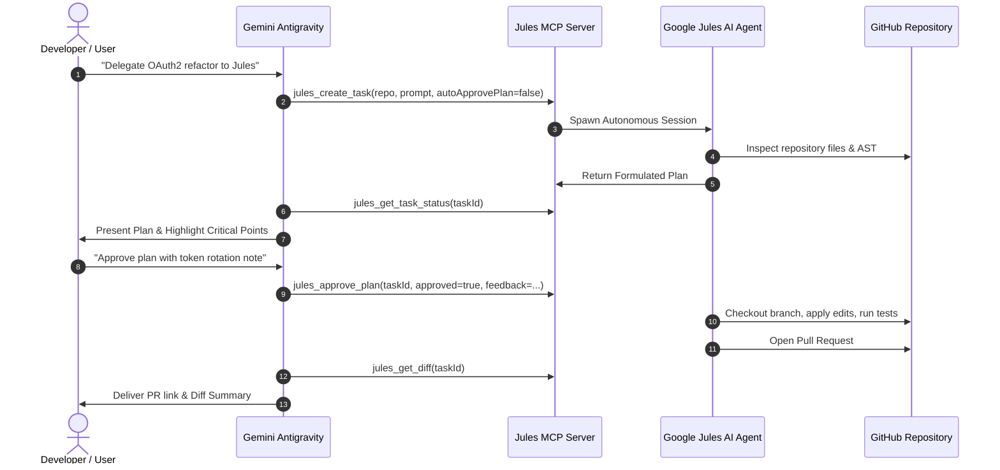

# Jules Orchestrator Skill

This skill guides Antigravity to act as the master orchestrator while delegating background coding sessions to **Google Jules AI** using the Model Context Protocol (MCP).

## When to Use Jules Orchestration

| Task Profile | Delegate to Jules AI | Keep in Antigravity |
| :--- | :--- | :--- |
| **Duration** | Background / Async (>10 mins) | Immediate pair programming |
| **Scope** | Multi-file refactors, dependency updates, boilerplate | Targeted surgical edits, architecture decisions |
| **Output** | Pull Request with automated testing in remote cloud | Direct local file patches (`replace_file_content`) |
| **Interaction** | Asynchronous plan review & steering | Real-time chat dialogue |

---

## Jules MCP Tool Reference

The `jules-ai` MCP server exposes 7 primary tools:

1. **`jules_create_task`**: Spawns a new autonomous task in Jules.
   - `repo`: GitHub repository in `owner/repo` format.
   - `prompt`: Comprehensive requirements, constraints, and test scenarios.
   - `autoApprovePlan`: Set `false` (recommended) to inspect the plan first.
2. **`jules_get_task_status`**: Inspects logs, execution phases, and step progress.
3. **`jules_list_tasks`**: Lists recent tasks and filter by repository.
4. **`jules_approve_plan`**: Approves execution plan or rejects with feedback.
5. **`jules_send_feedback`**: Sends steering feedback to Jules mid-flight.
6. **`jules_get_diff`**: Retrieves the live git diff and PR URL.
7. **`jules_cancel_task`**: Cancels execution.

---

## Orchestration Workflow (End-to-End)

---

## Operational Strategies & Best Practices

### 1. High-Precision Prompt Formulation
When invoking `jules_create_task`, do not provide vague instructions. Include:
* **Context**: Specific files or packages involved.
* **Acceptance Criteria**: What behavior or tests must pass.
* **Constraints**: Libraries not to touch, architectural patterns to respect.

### 2. Mandatory Plan Review Gate
Always keep `autoApprovePlan: false` for production codebases:
1. Call `jules_get_task_status`.
2. Inspect `plan.steps` and `filesTargeted`.
3. If an unnecessary file is targeted or a dangerous database migration is proposed, call `jules_approve_plan` with `approved: false` and specific steering feedback.

### 3. Non-Blocking Liveness (No Polling Loops)
Antigravity operates with reactive wakeups and scheduled timers:
* Do **NOT** poll `jules_get_task_status` in an infinite loop.
* Use the Antigravity `schedule` tool to set an async notification or check status upon user return.

### 4. Steering Mid-Session
If the user provides additional context while Jules is running:
* Call `jules_send_feedback(taskId, message)` to steer the agent without aborting the session.
