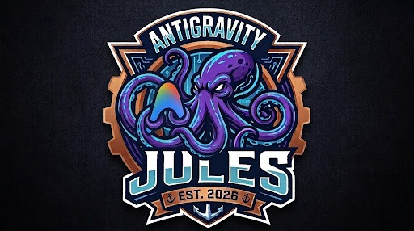

<p align="center">
  
</p>

<h1 align="center">Jules AI MCP Server & Antigravity Orchestration</h1>

<p align="center">
  <b>Complete integration between Google Jules AI and Gemini Antigravity via the Model Context Protocol (MCP).</b><br>
  Delegate asynchronous coding tasks, review execution plans, monitor sessions, and automate Pull Requests directly from Antigravity.
</p>

<p align="center">
  <a href="./README.md">🇧🇷 Documentação em Português</a> •
  <a href="#-overview">Overview</a> •
  <a href="#-setup-guide">Setup Guide</a> •
  <a href="#-gemini-antigravity-integration">Antigravity</a> •
  <a href="#-strategies--best-practices">Strategies</a> •
  <a href="#-mcp-tool-reference">MCP Tools</a>
</p>

---

## 🧭 Overview

**Google Jules** is Google's autonomous coding agent designed to run in the cloud, clone repositories, analyze codebases, formulate multi-step plans, and submit verified Pull Requests with automated test validation.

**Gemini Antigravity** is Google DeepMind's advanced pair-programming agent tailored for surgical edits, deep reasoning, and high-order system orchestration.

This repository bridges both using the **Model Context Protocol (MCP)**:
* **Antigravity** acts as the **Lead Architect**, designing solutions and supervising delivery.
* **Jules AI** acts as the **Asynchronous Cloud Builder**, executing long-running refactors, migrations, and test suites in the background.

```
┌─────────────────────────────────┐
│        Gemini Antigravity       │ ◄─── Pair Programming, Architecture,
│     (Orchestrator / Architect)  │      Plan Reviews & Diff Inspection
└────────────────┬────────────────┘
                 │ MCP (Model Context Protocol via Stdio)
┌────────────────▼────────────────┐
│        jules-ai-mcp Server      │ ◄─── Tool definitions, Types & Validation
└────────────────┬────────────────┘
                 │ Google Jules API / v1alpha
┌────────────────▼────────────────┐
│         Google Jules AI         │ ◄─── Cloud VM, Branching, Test Execution,
│    (Autonomous Coding Agent)    │      Pull Request Creation
└─────────────────────────────────┘
```

---

## 🚀 Setup Guide

### 1. Prerequisites
* **Node.js**: Version 18 or higher (`node -v`).
* **NPM**: Version 9 or higher (`npm -v`).
* **Google Jules Account**: Access to [jules.google](https://jules.google).
* **Jules API Key**: Generated from *Settings > API Keys* in the Jules dashboard.

### 2. Clone & Install
```bash
git clone https://github.com/Helfstein-one/jules-ai-mcp.git
cd jules-ai-mcp
npm install
npm run build
```

### 3. Environment Variables
Copy `.env.example` to `.env`:
```bash
cp .env.example .env
```
Set your credentials:
```env
JULES_API_KEY=your_jules_api_key_here
JULES_API_BASE_URL=https://jules.googleapis.com/v1alpha
JULES_MOCK_MODE=false
```

> [!TIP]
> To test without consuming live API tokens, keep `JULES_MOCK_MODE=true` to enable instant sandboxed task simulation.

---

## 🪐 Gemini Antigravity Integration

### 1. Register the MCP Server
Add the server entry to your global configuration (`~/.gemini/config/mcp_config.json`):

```json
{
  "mcpServers": {
    "jules-ai": {
      "command": "node",
      "args": ["/absolute/path/to/jules-ai-mcp/dist/index.js"],
      "env": {
        "JULES_API_KEY": "your_jules_api_key_here",
        "JULES_MOCK_MODE": "false"
      }
    }
  }
}
```

### 2. Load the `jules-orchestrator` Skill
This repository includes a production-ready Antigravity skill at [.agents/skills/jules-orchestrator/SKILL.md](file:///.agents/skills/jules-orchestrator/SKILL.md).
Copy the `.agents/` directory into your project workspace or `~/.gemini/config/skills/`.

The skill equips Antigravity to:
1. Identify suitable background tasks to offload to Jules.
2. Draft precise, constraint-driven task prompts.
3. Enforce plan inspection before any code modifications occur.
4. Retrieve and summarize git diffs and generated PR links.

---

## 🛠️ MCP Tool Reference

| MCP Tool | Main Parameters | Description |
| :--- | :--- | :--- |
| `jules_create_task` | `repo`, `prompt`, `baseBranch`, `autoApprovePlan` | Spawns a new autonomous coding session in Jules. |
| `jules_list_tasks` | `repo` (optional), `limit` | Lists active and historical tasks. |
| `jules_get_task_status`| `taskId` | Fetches live execution status, logs, and multi-step plan. |
| `jules_approve_plan` | `taskId`, `approved` (boolean), `feedback` | Approves or rejects the execution plan with steering notes. |
| `jules_send_feedback` | `taskId`, `message` | Sends mid-flight guidance or context to a running Jules task. |
| `jules_get_diff` | `taskId` | Retrieves unified git diff and PR URL. |
| `jules_cancel_task` | `taskId`, `reason` | Aborts an ongoing task. |

---

## 🧠 Strategies & Best Practices

### 1. Division of Labor
* **Antigravity**: Local pair programming, architecture design, 1-3 file surgical fixes, real-time debugging.
* **Jules**: Wide repo refactors, multi-file unit test generation, framework version migrations, long background sweeps.

### 2. Mandatory Plan Gate (`autoApprovePlan: false`)
Always require plan inspection on mission-critical codebases:
1. Jules constructs an AST dependency map and generates `plan.steps`.
2. Antigravity surfaces affected files and highlights breaking changes.
3. You review and adjust steps with `jules_approve_plan`.

### 3. Non-Blocking Orchestration
Never poll `jules_get_task_status` continuously. Use Antigravity's async scheduling and notifications so pair programming continues uninterrupted while Jules works in the cloud.

---

## 📄 License
Released under the [MIT](LICENSE) License.
Authored by [@Helfstein-one](https://github.com/Helfstein-one).
